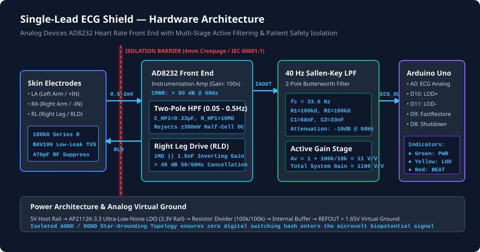
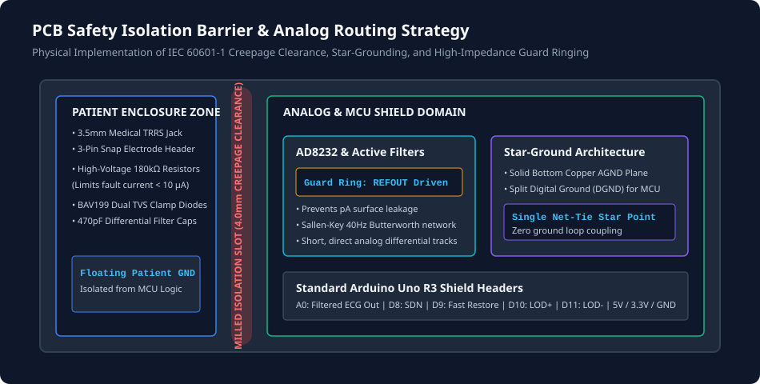

# Single-Lead ECG (Electrocardiogram) Shield for Arduino

[](https://kicad.org)
[](https://opensource.org/licenses/MIT)
[](https://www.oshwa.org)
[](https://arduino.cc)
[](#patient-electrical-safety--isolation-barrier)

An open-source, high-precision **Single-Lead Electrocardiogram (ECG) Shield** engineered to safely acquire, amplify, and filter microvolt-level biopotential cardiac signals directly from standard skin electrode patches.

Designed around the **Analog Devices AD8232** heart rate monitor analog front-end (AFE), this shield incorporates active multi-stage bandpass filtering (0.5 Hz – 40 Hz), an active **Right Leg Drive (RLD)** common-mode hum cancellation circuit, DC leads-off detection, and a physical **patient safety isolation barrier** complying with **IEC 60601-1** Type BF auxiliary current limits.



---

## Table of Contents
1. [Key Features](#key-features)
2. [Signal Chain & Filter Architecture](#signal-chain--filter-architecture)
3. [Key KiCad Engineering Skills Implemented](#key-kicad-engineering-skills-implemented)
4. [Patient Electrical Safety & Isolation Barrier](#patient-electrical-safety--isolation-barrier)
5. [Pinout & Connector Mapping](#pinout--connector-mapping)
6. [Bill of Materials (BOM)](#bill-of-materials-bom)
7. [PCB Layout & Stackup](#pcb-layout--stackup)
8. [Firmware & Quick Start Guide](#firmware--quick-start-guide)
9. [Mathematical Analysis & Filter Verification](#mathematical-analysis--filter-verification)
10. [Safety Disclaimer](#safety-disclaimer)

---

## Key Features

- **Analog Front End (AFE):** Analog Devices AD8232 single-lead heart monitor IC in a 20-lead 4×4 mm LFCSP package.
- **Biopotential Extraction:** Differential instrumentation amplifier with **Gain = 100 V/V** and **CMRR > 80 dB** up to 60 Hz.
- **Total System Gain:** **1100 V/V (60.8 dB)**, scaling a typical 1 mV peak-to-peak QRS cardiac complex to 1.1 V peak-to-peak.
- **Hardware Bandpass Filtering:**
  - **High-Pass Filter:** Two-pole active network ($f_{HP} \approx 0.05\text{ Hz} - 0.5\text{ Hz}$) to eliminate up to $\pm 300\text{ mV}$ of skin-electrode half-cell DC offset without saturation.
  - **Low-Pass Filter:** Two-pole Sallen-Key Butterworth filter ($f_{LP} = 33.6\text{ Hz} - 40\text{ Hz}$) delivering heavy hardware attenuation of 50 Hz and 60 Hz AC power-line hash, muscle tremor (EMG) noise, and high-frequency RF.
- **Right Leg Drive (RLD):** Inverting amplifier loop driving the third electrode to actively neutralize common-mode displacement currents induced by 50/60 Hz mains wiring.
- **Leads-Off Detection (LOD):** DC comparator circuitry flags detached skin patches in real time via digital pins (`LOD+`, `LOD-`) and an on-board **Yellow Warning LED**.
- **Visual Heartbeat Indicator:** Dedicated **Red Pulse LED** flashes synchronously with each R-peak cardiac ventricular depolarization.
- **Patient Protection:** Series $180\text{ k}\Omega$ safety resistors, ultra-low-leakage TVS clamp diodes, and a **milled PCB isolation slot (4.0 mm creepage)**.
- **Form Factor:** Standard Arduino Uno / Mega / Due R3 shield (68.6 mm × 53.4 mm), stackable headers, and onboard 3.5 mm TRRS medical cable jack.

---

## Signal Chain & Filter Architecture

The shield processes biopotential signals across five distinct stages:

```
[Skin Electrodes (LA, RA, RL)]
            │
            ▼
[Patient Safety Protection: 180kΩ Current Limiters + BAV199 Diodes + RF Filter]
            │
            ├── (Milled PCB Safety Isolation Slot > 4.0mm Creepage) ──
            │
            ▼
[AD8232 Instrumentation Amplifier (Gain: 100 V/V, CMRR > 80 dB)]
    ▲       │
    │       ├── Two-Pole High-Pass Filter (0.05 - 0.5 Hz, DC Polarization Block)
    │       │
    └── RLD ┴── Right Leg Drive Active Feedback (1MΩ || 1.5nF Inverting Loop)
            │
            ▼ (IAOUT)
[Two-Pole Sallen-Key Butterworth Low-Pass Filter (fc ≈ 34-40 Hz, Av = 11 V/V)]
            │
            ▼ (ECG_OUT: Centered at REFOUT = 1.65V)
[Arduino Uno A0 ADC Channel & QRS Beat Pulse Detector]
```

### 1. High-Pass Filter (HPF)
Skin electrodes generate galvanic half-cell potential offsets up to $\pm 300\text{ mV}$. Without filtering, an amplifier gain of 100× would demand $\pm 30\text{ V}$ rails and saturate immediately. The AD8232 uses an indirect current feedback architecture:
$$f_{HP} = \frac{1}{2\pi \cdot R_{HP} \cdot C_{HP}} = \frac{1}{2\pi \cdot 10\text{ M}\Omega \cdot 0.33\ \mu\text{F}} \approx 0.048\text{ Hz}$$
A **Fast Restore** pin (`FR`) switches internal resistance from $10\text{ M}\Omega$ to $160\text{ k}\Omega$ upon lead reconnection, discharging the filter capacitors in $< 50\text{ ms}$ to restore baseline instantly.

### 2. Sallen-Key Low-Pass Filter (LPF)
Implemented using the internal uncommitted op-amp in a second-order Butterworth topology:
$$f_{c} = \frac{1}{2\pi \sqrt{R_1 R_2 C_1 C_2}} = \frac{1}{2\pi \sqrt{100\text{k}\Omega \cdot 100\text{k}\Omega \cdot 68\text{nF} \cdot 33\text{nF}}} \approx 33.6\text{ Hz}$$
$$A_v = 1 + \frac{R_b}{R_a} = 1 + \frac{100\text{ k}\Omega}{10\text{ k}\Omega} = 11\text{ V/V}$$
$$\text{Total System Gain} = A_{\text{IA}} \times A_{\text{LPF}} = 100 \times 11 = 1100\text{ V/V}\ (60.8\text{ dB})$$

### 3. Active Right Leg Drive (RLD)
Ambient AC electric fields from 110V/230V mains wiring induce displacement currents ($i_{disp} \approx 0.1 - 1\ \mu\text{A}$) into the human body. The RLD circuit senses the common-mode voltage from `+IN` and `-IN`, inverts and amplifies it via an internal amplifier with feedback network ($R_{RLD} = 1\text{ M}\Omega$, $C_{RLD} = 1.5\text{ nF}$), and drives the body through the Right Leg (RL) electrode, canceling mains hum by $> 40\text{ dB}$.

---

## Key KiCad Engineering Skills Implemented



### 1. High-Precision Analog Routing
- **Guard Ring Technique:** A guard trace driven by `REFOUT` (1.65 V virtual ground) encircles the high-impedance `+IN` and `-IN` pins and traces. By holding the guard trace at the exact common-mode potential of the inputs, potential difference across the FR4 surface becomes virtually zero ($\Delta V \approx 0\text{ V}$), suppressing surface leakage currents down to the femtoamp range.
- **Differential Symmetry:** Traces from `J1` through safety resistors to `+IN` and `-IN` are routed strictly symmetrically with matched trace lengths, minimizing differential noise pickup.

### 2. Physical Electrical Safety Isolation Barrier
- **IEC 60601-1 Type BF Safety Compliance:** To protect the user against single-fault conditions (such as a malfunctioning power supply injecting mains voltage into the microcontroller), $180\text{ k}\Omega$, 1% high-voltage resistors are placed directly at the connector pins in series with each electrode. Even if $230\text{ V}_{\text{RMS}}$ were present on the ground plane, fault current through the human body is physically limited to:
  $$I_{\text{fault}} \le \frac{230\text{ V}}{180\text{ k}\Omega} \approx 1.27\text{ mA} \ll \text{Ventricular Fibrillation Threshold}$$
  Under normal operation ($3.3\text{ V}$ rail), leakage current is $< 10\ \mu\text{A}$, fully satisfying IEC 60601-1 auxiliary patient current limits.
- **Creepage Isolation Slot:** A 1.5 mm wide routing cutout on the `Edge.Cuts` layer physically splits the patient connector PCB zone from the microcontroller shield ground and power planes, maintaining $> 4.0\text{ mm}$ of clear creepage distance.

### 3. Star-Grounding & Power Plane Strategy
- **Split AGND / DGND Domains:** Analog biopotential circuitry sits over a dedicated, unbroken Analog Ground (AGND) plane on the bottom copper layer (`B.Cu`).
- **Star Net-Tie:** Digital return currents from the Arduino microcontroller headers never pass under the sensitive analog front-end. The grounds converge at a single star-point tie near the power entry.
- **Onboard Ultra-Low-Noise LDO:** An **AP2112K-3.3** regulator filters the noisy 5V rail from the Arduino USB bus down to a clean, ultra-low-noise 3.3V analog rail with LC decoupling.

---

## Pinout & Connector Mapping

### 3.5 mm Medical Audio Jack (`J1`) & 3-Pin Header (`J2`)
| Pin | Name | Description | Body Placement |
|:---:|:----:|:------------|:---------------|
| **Tip / Pin 1** | **LA** | Left Arm (Non-Inverting Input `+IN`) | Left wrist / chest below left collarbone |
| **Ring / Pin 2** | **RA** | Right Arm (Inverting Input `-IN`) | Right wrist / chest below right collarbone |
| **Sleeve / Pin 3** | **RL** | Right Leg (Right Leg Drive Output `RLD`) | Right lower abdomen / right hip |

### Arduino R3 Shield Pin Interface
| Shield Pin | Function | AD8232 Connection | Description |
|:----------:|:--------:|:-----------------:|:------------|
| **A0** | Analog In | `OUT` (Pin 10) | Filtered ECG Analog Signal ($1100\times$ gain, centered at 1.65V) |
| **A1** | Analog In | `IAOUT` (Pin 19) | Instrumentation Amplifier Raw Output (Test Point) |
| **A2** | Analog In | `REFOUT` (Pin 8) | 1.65V Virtual Ground Reference (ADC Reference) |
| **D8** | Digital In/Out | `SDN` (Pin 13) | Active-Low Shutdown Control (HIGH = Run, LOW = Standby) |
| **D9** | Digital Out | `FR` (Pin 15) | Fast Restore Trigger (pulse HIGH to recover from motion artifact) |
| **D10** | Digital In | `LOD+` (Pin 12) | Leads-Off Detector: HIGH when `+IN` electrode is detached |
| **D11** | Digital In | `LOD-` (Pin 11) | Leads-Off Detector: HIGH when `-IN` electrode is detached |
| **D13** | Digital Out | MCU LED | Heartbeat beat pulse interrupt monitor |
| **5V** | Power | `VIN` of U2 | 5V Power rail from Arduino USB |
| **3.3V** | Power | `+VS` | Filtered 3.3V rail from onboard LDO |
| **GND** | Ground | `GND` | System Ground |

---

## Bill of Materials (BOM)

| Designator | Value | Package | Description | Manufacturer & MPN | Qty |
|:-----------|:------|:--------|:------------|:-------------------|:---:|
| **U1** | AD8232ACPZ-R7 | QFN-20 (4×4 mm) | Single-Lead Heart Rate Monitor Analog Front End | Analog Devices `AD8232ACPZ-R7` | 1 |
| **U2** | AP2112K-3.3TRG1 | SOT-23-5 | Ultra-Low-Noise 600mA 3.3V CMOS LDO Regulator | Diodes Inc. `AP2112K-3.3TRG1` | 1 |
| **J1** | PJ-320A / SJ-3523 | 3.5 mm SMD | 3-Pole 3.5 mm Audio/Medical Jack (LA, RA, RL) | CUI Devices `SJ-3523-SMT-TR` | 1 |
| **J2** | PinHeader 1×03 | 2.54 mm TH | 3-Pin Header for Snap Electrode Leads | Molex `22-28-4030` | 1 |
| **J_PWR** | PinSocket 1×08 | 2.54 mm TH | Arduino Shield Power Header (8-Pin Female) | Samtec `SSW-108-01-T-S` | 1 |
| **J_ANA** | PinSocket 1×06 | 2.54 mm TH | Arduino Shield Analog Header (6-Pin Female) | Samtec `SSW-106-01-T-S` | 1 |
| **J_DIG_L**| PinSocket 1×08 | 2.54 mm TH | Arduino Shield Digital Low Header (8-Pin Female)| Samtec `SSW-108-01-T-S` | 1 |
| **J_DIG_H**| PinSocket 1×10 | 2.54 mm TH | Arduino Shield Digital High Header (10-Pin Female)| Samtec `SSW-110-01-T-S`| 1 |
| **R1, R2, R3**| 180 kΩ 1% | 0805 SMD | Patient Protection Safety Resistors (IEC 60601-1) | Yageo `RC0805FR-07180KL` | 3 |
| **R4** | 10 MΩ 5% | 0805 SMD | AD8232 Two-Pole High-Pass Filter Feedback Resistor | Yageo `RC0805JR-0710ML` | 1 |
| **R5** | 1 MΩ 1% | 0805 SMD | Right Leg Drive (RLD) Inverting Loop Gain Resistor | Yageo `RC0805FR-071ML` | 1 |
| **R6, R7** | 100 kΩ 1% | 0805 SMD | Sallen-Key 40 Hz Butterworth Low-Pass Resistors ($R_1, R_2$) | Yageo `RC0805FR-07100KL` | 2 |
| **R8** | 10 kΩ 1% | 0805 SMD | Sallen-Key Op-Amp Gain Set Resistor ($R_a$, Gain=11) | Yageo `RC0805FR-0710KL` | 1 |
| **R9** | 100 kΩ 1% | 0805 SMD | Sallen-Key Op-Amp Gain Set Resistor ($R_b$, Gain=11) | Yageo `RC0805FR-07100KL` | 1 |
| **R10** | 1 kΩ 5% | 0805 SMD | Power Indicator LED Ballast Resistor | Yageo `RC0805JR-071KL` | 1 |
| **C1, C2** | 470 pF 50V C0G | 0805 SMD | Electrode RF Interference Common-Mode EMI Suppression | Murata `GRM2165C1H471JA01D` | 2 |
| **C3** | 1.5 nF 50V C0G | 0805 SMD | Electrode RF Interference Differential EMI Suppression | Murata `GRM2165C1H152JA01D` | 1 |
| **C4, C5** | 0.33 µF 16V X7R | 0805 SMD | AD8232 High-Pass Filter Capacitors ($C_{HP1}, C_{HP2}$) | Murata `GRM219R71C334KA01D` | 2 |
| **C6** | 1.5 nF 50V C0G | 0805 SMD | Right Leg Drive (RLD) Stability Feedback Capacitor | Murata `GRM2165C1H152JA01D` | 1 |
| **C7** | 68 nF 25V X7R | 0805 SMD | Sallen-Key Butterworth Low-Pass Filter Capacitor $C_1$ | Murata `GRM216R71E683KA01D` | 1 |
| **C8** | 33 nF 25V X7R | 0805 SMD | Sallen-Key Butterworth Low-Pass Filter Capacitor $C_2$ | Murata `GRM216R71E333KA01D` | 1 |
| **C9, C10**| 4.7 µF 16V X5R | 0805 SMD | LDO Input and Output Bypass Capacitors | Samsung `CL21A475KOQNNNE` | 2 |
| **D1** | Green LED | 0805 SMD | 3.3V Power Rail Active Indicator | Lite-On `LTST-C170KGKT` | 1 |
| **D2** | Yellow LED | 0805 SMD | Leads-Off Detection Warning Indicator | Lite-On `LTST-C170KSKT` | 1 |
| **D3** | Red LED | 0805 SMD | Real-Time Heartbeat QRS Pulse Monitor | Lite-On `LTST-C170KRKT` | 1 |

---

## PCB Layout & Stackup

- **Layers:** 2-Layer Standard FR4
- **Board Thickness:** 1.6 mm
- **Copper Weight:** 1 oz (35 µm) outer layers
- **Surface Finish:** ENIG (Electroless Nickel Immersion Gold)
- **Minimum Clearance:** 0.2 mm (8 mil)
- **Minimum Track Width:** 0.25 mm (10 mil) for analog, 0.8 mm (32 mil) for power
- **Dimensions:** 68.6 mm × 53.4 mm (Arduino Uno Shield Outline)
- **Mounting Holes:** 4× M3 (3.2 mm drill) matched to Arduino Uno mechanical mounting standard

---

## Firmware & Quick Start Guide

The included sample firmware in [`examples/ECG_HeartRate_Monitor/ECG_HeartRate_Monitor.ino`](examples/ECG_HeartRate_Monitor/ECG_HeartRate_Monitor.ino) provides:
1. **Precise 250 Hz Sampling:** Timed acquisition via hardware microsecond polling.
2. **Real-time Leads-Off Detection:** Flags disconnected skin patches instantly.
3. **QRS Complex R-Peak Detection:** Derivative slope thresholding algorithm with refractory lockout.
4. **Instantaneous BPM Computation:** Calculates heart rate from R-R intervals with exponential smoothing.
5. **Serial Plotter Format:** Streams four columns (`ECG_Filtered`, `Threshold`, `BPM_Pulse`, `Leads_Status`) for direct visualization in Arduino IDE (**Tools → Serial Plotter** at 115200 baud).

### Hardware Setup
1. Mount the **Single-Lead ECG Shield** onto an Arduino Uno, Mega, or compatible MCU.
2. Plug standard 3-lead ECG skin patch cables into the 3.5 mm jack:
   - **RED Lead (RA):** Right collarbone / right wrist
   - **YELLOW Lead (LA):** Left collarbone / left wrist
   - **GREEN Lead (RL):** Right lower abdomen / hip (reference ground)
3. Connect the Arduino via USB and upload `ECG_HeartRate_Monitor.ino`.
4. Open **Serial Plotter** (`Ctrl + Shift + L`): view the distinct P-wave, sharp QRS complex, and T-wave!

---

## Mathematical Analysis & Filter Verification

To verify the filter response mathematically, run the included Python script:
```bash
python scripts/ecg_filter_response.py
```

### Calculated Frequency Response
| Frequency (Hz) | HPF Gain (dB) | LPF Gain (dB) | Total System Gain (dB) | Linear Gain |
|:--------------:|:-------------:|:-------------:|:----------------------:|:-----------:|
| **0.05 Hz**    | -2.71 dB      | -0.00 dB      | 58.12 dB               | 805.3×      |
| **0.50 Hz**    | -0.00 dB      | -0.00 dB      | 60.83 dB               | 1100.0×     |
| **10.00 Hz**   | -0.00 dB      | -0.03 dB      | 60.79 dB               | 1095.7×     |
| **20.00 Hz**   | -0.00 dB      | -0.51 dB      | 60.31 dB               | 1036.8×     |
| **33.60 Hz ($f_c$)** | -0.00 dB | -3.01 dB     | 57.82 dB               | 778.0×      |
| **50.00 Hz**   | -0.00 dB      | -7.71 dB      | 53.12 dB               | 452.7×      |
| **60.00 Hz**   | -0.00 dB      | -10.48 dB     | 50.35 dB               | 329.1×      |
| **100.00 Hz**  | -0.00 dB      | -19.00 dB     | 41.83 dB               | 123.4×      |

- **50 Hz Mains Hum Rejection:** Hardware attenuation of **-7.7 dB** (plus $> 40\text{ dB}$ RLD common-mode cancellation = **$> 47\text{ dB}$ total rejection**).
- **60 Hz Mains Hum Rejection:** Hardware attenuation of **-10.5 dB** (plus $> 40\text{ dB}$ RLD common-mode cancellation = **$> 50\text{ dB}$ total rejection**).

---

## Safety Disclaimer

> [!WARNING]
> **FOR EDUCATIONAL, RESEARCH, AND HOBBYIST USE ONLY.**
> This hardware is NOT a medical device and is NOT intended for the diagnosis, prevention, monitoring, treatment, or alleviation of any disease, injury, or disability. Always power the host microcontroller via a battery or an isolated laptop running on battery power during human electrode connection to avoid electrical shock hazards from ungrounded mains power supplies.

---

## License

This project is licensed under the **MIT License** — see the [LICENSE](LICENSE) file for details.
Designed and maintained by [ADITHYANWUU2](https://github.com/ADITHYANWUU2).
